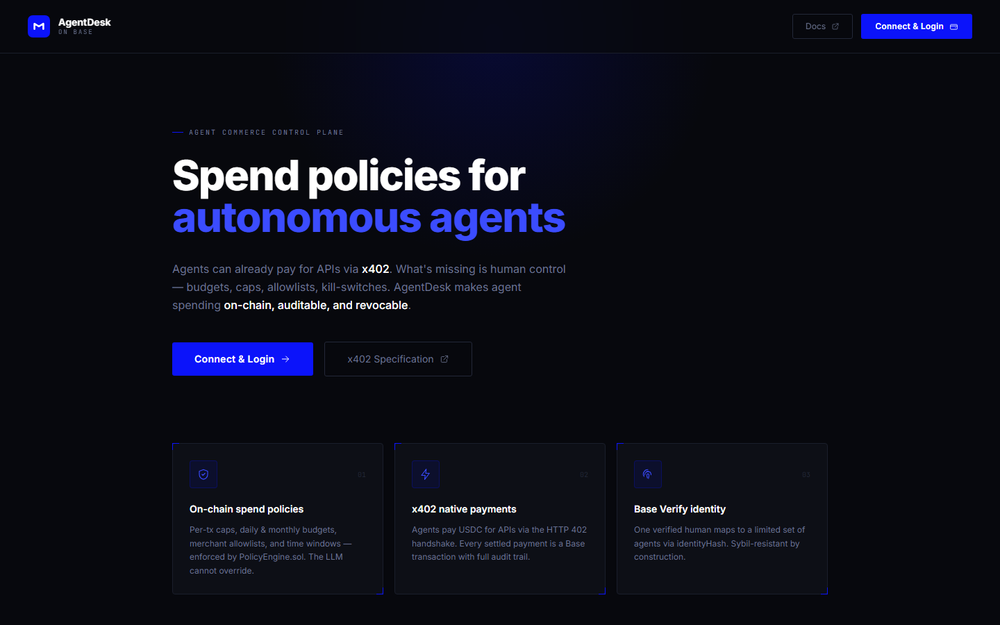
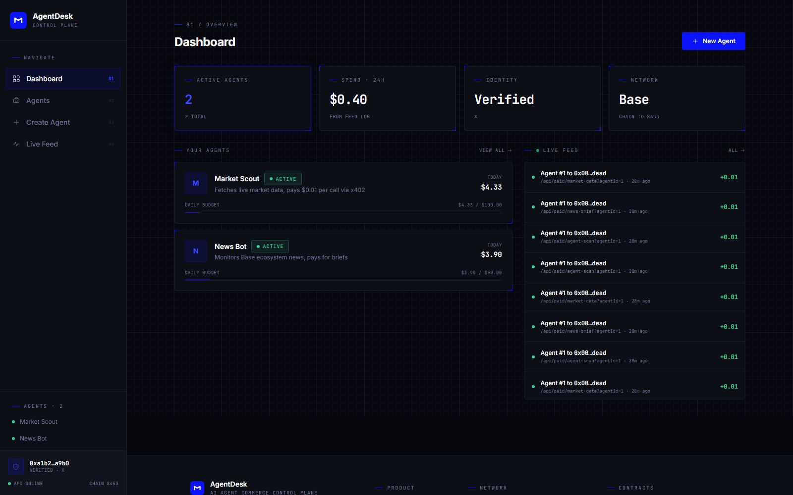
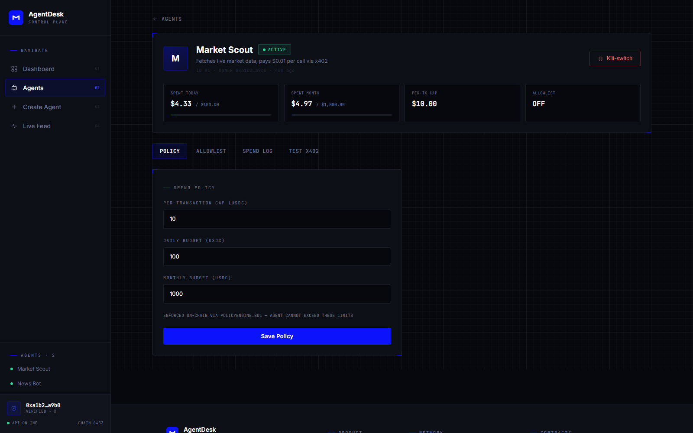

# AgentDesk

**AI Agent Commerce Control Plane on Base**

The missing layer between humans and autonomous agents: create agents, fund them, enforce spend
policies, and pay for APIs via **x402** — with Base-native identity.



## Why AgentDesk?

Base shipped **x402** (HTTP-native payments) and **Base Verify** (sybil-resistant identity). Agents can
already pay for APIs — but **humans have zero control**: no budgets, no per-transaction caps, no
merchant allowlists, no live spend visibility, no kill switch.

AgentDesk adds a policy engine + control dashboard: every agent is a wallet you own, every payment is
checked against caps you set (on-chain in chain mode), and you can halt an agent instantly.

| Console | Agent detail (policy + allowlist) |
| --- | --- |
|  |  |

## Two modes

| Mode | When | Writes | Reads |
| --- | --- | --- | --- |
| **local** (demo) | `AGENT_REGISTRY_ADDRESS` / `POLICY_ENGINE_ADDRESS` unset | JSON demo DB over the REST API | JSON demo DB |
| **chain** (real) | both addresses set (`.env`) | your wallet → `AgentRegistry` / `PolicyEngine` on Base | contracts + event logs, server is read-only |

Chain mode is what runs on Base Sepolia today: AgentRegistry
`0x9869658193c68342A986fabe3b2E5A9b2F6BD476`, PolicyEngine
`0x9Dc1Ba1A80885f339F906A7f73d16D292eA21E1b`.

## Layout

```
agentdesk/
├─ api/                Vercel serverless entry (rewrites /api/* → Express app)
├─ contracts/          Solidity policy engine
│  ├─ src/             AgentRegistry.sol · PolicyEngine.sol
│  ├─ scripts/         deploy.js · export-abis.js
│  ├─ abi/             exported ABIs
│  └─ deployments/     baseSepolia.json (addresses + deploy block)
├─ server/             REST API + x402 middleware (Express, viem, nodeps JSON DB)
│  └─ src/             app.js · auth.js · chain.js · config.js · middleware/ · services/ · db/
├─ web/                Control dashboard + landing (React, Vite, Tailwind, wagmi/Privy)
│  └─ src/             pages/ · components/ · lib/ · abi/ · styles/
├─ examples/           agent-client.js — machine-to-machine x402 caller
├─ docs/               API.md · assets/ (screenshots)
├─ tools/              operator scripts (not shipped to users)
│  ├─ e2e/             api-e2e.mjs · ui-e2e.mjs · cleanup.mjs · run-e2e.ps1
│  ├─ chain/           chain-smoke.mjs · chain-status.mjs · build-chain.ps1
│  └─ faucet/          mine-and-claim.ps1 (PoW testnet ETH, no login)
├─ README.md · DEPLOY.md · SECURITY.md
└─ .env.example · vercel.json · package.json
```

## Quickstart

```bash
npm install                     # root (tooling: e2e, chain scripts)
cd server && npm install        # API deps        (viem, express, zod, @privy-io/node)
cd ../web && npm install        # dashboard deps  (@stripe/stripe-js + .npmrc legacy-peer-deps)
cd ../contracts && npm install  # hardhat         (deploy only)

cp .env.example .env            # leave the contract addresses empty → local demo mode
npm run dev                     # API :8787 + Vite :5173  (run from the repo root)
```

Open <http://localhost:8787> (built UI + API) or <http://localhost:5173> (Vite dev server).
Connect a wallet → sign in → create an agent → set caps → run a paid request.

### Chain mode (Base Sepolia)

Set `AGENT_REGISTRY_ADDRESS`, `POLICY_ENGINE_ADDRESS`, `DEPLOY_BLOCK` in `.env` (see `DEPLOY.md`), then
`npm run dev` again — the banner flips to **CHAIN MODE** and all writes go through your wallet:

```bash
npm run build:chain             # build the UI in chain mode (VITE_* addresses)
npm run chain:status            # read-only sanity check of the deployed contracts
npm run chain:smoke             # create agent + policy + spend on-chain (deployer key)
```

Need testnet ETH for a fresh wallet? The OpenFaucet flow is proof-of-work only, no login:

```bash
npm run faucet -- -Address 0xYourWallet -Secs 600 -Claim
```

## Commands

| Command | What |
| --- | --- |
| `npm run dev` | API + web dev servers (API serves the built UI on :8787) |
| `npm run build` | production UI build → `web/dist` (local mode) |
| `npm run build:chain` | UI build wired to the deployed contracts |
| `npm run deploy:sepolia` | compile + deploy contracts, print addresses |
| `npm run e2e` | full API + UI suite, twice, leaves the server up |
| `npm run e2e:api` · `e2e:ui` · `e2e:clean` | individual suites / demo-data cleanup |
| `npm run chain:status` · `chain:smoke` | read-only chain check / on-chain write smoke test |
| `npm run faucet -- -Address 0x…` | PoW faucet claim (testnet ETH) |

## Core concepts

**Agent** — a wallet owned by the human, operated by software. Identity is `keccak256(owner)` on-chain;
the spend policy is what actually gates the money.

**Policy** — `perTxCap`, `dailyBudget`, `monthlyBudget`, optional merchant allowlist, optional time
window, `paused` kill switch. In chain mode these live in `PolicyEngine.sol` and are read via
`canSpend()`.

**x402 flow** — 1) agent calls a paid endpoint → `402 Payment Required`; 2) server checks the agent's
policy (`canSpend` on-chain in chain mode); 3) the client's EIP-3009 USDC authorization is validated
against the challenge (payee, amount, asset, window) and settled by the x402 facilitator; 4) the
resource is returned with an `X-Payment-Settlement` proof. In local mode settlement is mocked so the
whole flow is demoable offline.

**Identity** — `POST /api/auth/verify` accepts a Privy identity token (with `linked_accounts`) or a
SIWE signature, and issues the app's own 7-day HMAC JWT. One unverified human → 1 agent, verified → 5
(Base Verify adapter in `server/src/services/verify.js`).

## Security

See [SECURITY.md](SECURITY.md) for the threat model, the review findings (all fixed) and the known
limitations. Highlights: JWT-authenticated ownership on every write, chain-mode x402 payload binding
(no free/underpaid resources), no default `AUTH_SECRET` in production, and rate-limited auth/paid
endpoints.

## Deploy

`DEPLOY.md` walks through contracts, Vercel (env vars, `vercel.json`), Privy, and the post-deploy
verification list.

## Grant alignment

| Base grant category | How AgentDesk fits |
| --- | --- |
| Agents — commerce, x402 | Core product |
| Consumer apps (tx growth) | Every agent payment is a transaction |
| DeFi 2.0 (payments rail) | USDC settlement on Base |

## License

MIT
